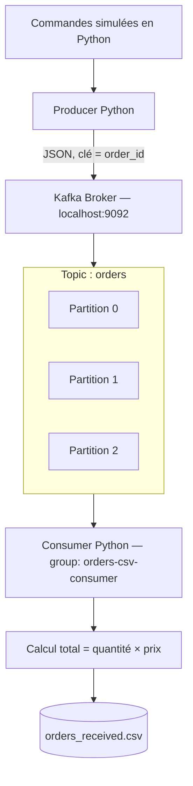

# 🛒 Projet Data Engineering — Streaming de commandes avec Apache Kafka, Python et Docker


> **TP pratique — Data Engineering / Event Streaming.** On simule des commandes d'une boutique e-commerce, on les publie dans un **topic Kafka**, puis un consommateur Python les récupère en continu, calcule leur montant et les sauvegarde dans un fichier CSV.
>
> **بالدارجة:** غادي نديرو تطبيق كيرسل commandes لـ Kafka، وتطبيق آخر كيقرأهم مباشرة وكيكتبهم فـ CSV.

**Sommaire**

1. [Objectifs pédagogiques](#1--objectifs-pédagogiques)
2. [Pourquoi Apache Kafka ?](#2--pourquoi-apache-kafka-)
3. [Les concepts fondamentaux](#3--les-concepts-fondamentaux)
4. [Architecture du projet](#4--architecture-du-projet)
5. [Structure des fichiers](#5--structure-des-fichiers)
6. [Prérequis](#6--prérequis)
7. [Installation pas à pas](#7--installation-pas-à-pas)
8. [Comprendre le Producer](#8--comprendre-le-producer)
9. [Comprendre le Consumer](#9--comprendre-le-consumer)
10. [Résultats attendus](#10--résultats-attendus)
11. [Partitions, offsets et consumer groups](#11--partitions-offsets-et-consumer-groups)
12. [Expériences pratiques](#12--expériences-pratiques)
13. [Commandes utiles](#13--commandes-utiles)
14. [Problèmes fréquents](#14--problèmes-fréquents)
15. [Limites et améliorations possibles](#15--limites-et-améliorations-possibles)

---

## 1 — Objectifs pédagogiques

À la fin de ce projet, vous saurez :

- expliquer la différence entre **batch processing** et **stream processing** ;
- distinguer **Producer**, **Broker**, **Topic**, **Partition** et **Consumer** ;
- lancer Kafka avec **Docker Compose**, en mode **KRaft** (sans ZooKeeper) ;
- créer un topic avec plusieurs partitions ;
- envoyer des événements JSON depuis un script Python ;
- consommer les événements et les enregistrer dans un fichier CSV ;
- interpréter les **offsets**, les **consumer groups** et les risques de doublons.

### Cas métier

Imaginez un site e-commerce qui reçoit des commandes tout au long de la journée. Au lieu de faire communiquer directement chaque service, le service **Orders** émet un événement `order_created`. D'autres services peuvent le recevoir indépendamment : statistiques, facturation, gestion des stocks, notifications… Dans ce TP, nous implémentons un seul consommateur, qui exporte les commandes en CSV.

---

## 2 — Pourquoi Apache Kafka ?

**Apache Kafka** est une plateforme distribuée d'**event streaming**. Elle reçoit, conserve et permet de relire des événements. Un événement est un fait métier, par exemple « la commande 101 vient d'être créée ».

Sans Kafka, deux programmes peuvent être très couplés : si le programme de destination est indisponible, l'envoi échoue. Avec Kafka, le Producteur publie dans un topic et le Consommateur récupère les messages selon sa disponibilité **tant que les messages sont conservés** dans Kafka.

| Traitement batch | Traitement streaming |
|---|---|
| Exemple : traiter un fichier CSV chaque soir | Exemple : réagir aux commandes à leur arrivée |
| Traitement par lots | Traitement continu d'événements |
| Souvent planifié | Souvent déclenché par l'arrivée de données |
| Airflow convient bien à l'orchestration de tâches batch | Kafka convient à la diffusion et à la conservation d'événements |

> **Kafka n'est pas une base de données relationnelle ni un outil ETL complet.** Il transporte et stocke des flux d'événements ; les transformations sont réalisées par des applications ou des outils complémentaires.

---

## 3 — Les concepts fondamentaux

| Concept | Description | Dans notre projet |
|---|---|---|
| **Producer** | Application qui publie des événements | `producer/producer.py` |
| **Broker** | Serveur Kafka qui stocke les messages | Conteneur Docker `kafka-orders` |
| **Topic** | Flux logique portant un nom | `orders` |
| **Partition** | Journal ordonné à l'intérieur d'un topic | 3 partitions (0, 1, 2) |
| **Message / Event** | Donnée envoyée à Kafka | Commande JSON |
| **Key** | Clé utilisée notamment pour le partitionnement | `order_id` |
| **Consumer** | Application qui lit les messages | `consumer/consumer.py` |
| **Consumer Group** | Ensemble de consommateurs qui se répartissent les partitions | `orders-csv-consumer` |
| **Offset** | Position d'un message **dans sa partition** | `0`, `1`, `2`, etc. |
| **Retention** | Durée / politique de conservation des événements | Configuration par défaut de Kafka |

### Exemple d'événement envoyé

```json
{
  "order_id": 101,
  "product": "Laptop",
  "quantity": 1,
  "price": 6500,
  "created_at": "2026-11-24T09:00:00+00:00"
}
```

`created_at` est généré à l'exécution : la date ci-dessus est **illustrative**. Les prix sont des montants de démonstration exprimés en MAD.

---

## 4 — Architecture du projet



**Important :** le schéma représente le flux logique. Kafka décide de la partition en fonction de la clé et du partitionneur du client. L'ordre des messages est garanti **à l'intérieur d'une même partition**, pas entre toutes les partitions du topic.

### Chemin suivi par une commande

1. Le Producer crée un dictionnaire Python contenant la commande.
2. Il convertit le dictionnaire en **JSON**.
3. Il publie l'événement dans le topic `orders`, avec `order_id` comme clé.
4. Le Broker écrit le message dans une partition et lui attribue un offset.
5. Le Consumer récupère le message, le décode et calcule `total`.
6. Le Consumer écrit une ligne dans `orders_received.csv` puis valide sa progression via un **commit d'offset**.

---

## 5 — Structure des fichiers

```text
kafka-orders-streaming/
├── docker-compose.yml          # Broker Kafka (KRaft)
├── requirements.txt            # Dépendances Python
├── producer/
│   └── producer.py             # Envoie six commandes au topic orders
├── consumer/
│   └── consumer.py             # Lit les messages et produit le CSV
├── .gitignore                  # Ignore les fichiers temporaires / CSV produit
└── README.md                   # Ce guide
```

Le fichier `orders_received.csv` est créé automatiquement **à la racine du projet** par le Consumer ; il n'est pas fourni dans l'archive initiale.

---

## 6 — Prérequis

- **Docker Desktop** démarré (Windows/macOS), ou Docker Engine + Compose v2 (Linux).
- **Python 3.10+** et `pip`.
- Un terminal (PowerShell, Terminal macOS ou Bash).
- Le port **9092** disponible sur votre machine.
- Une connexion Internet lors du premier téléchargement des images et des dépendances.

Vérifier les installations :

```bash
docker --version
docker compose version
python --version
```

Sur Windows, si `python` n'est pas disponible, essayer `py --version`.

---

## 7 — Installation pas à pas

### Étape 1 — Récupérer les fichiers

Télécharger l'archive du projet, l'extraire puis ouvrir le terminal dans le dossier `kafka-orders-streaming`.

Si le dépôt a déjà été publié sur votre compte GitHub :

```bash
git clone https://github.com/VOTRE_USERNAME/kafka-orders-streaming.git
cd kafka-orders-streaming
```

Remplacer `VOTRE_USERNAME` par votre identifiant GitHub ; ce lien est un **exemple**, pas un dépôt déjà publié.

### Étape 2 — Lancer Kafka

```bash
docker compose up -d
```

Docker télécharge l'image `apache/kafka:3.9.1` si nécessaire, puis lance un Broker Kafka en mode **KRaft** (sans ZooKeeper).

Vérifier les services :

```bash
docker compose ps
```

Observer les logs en cas de problème :

```bash
docker compose logs -f kafka
```

Faire `Ctrl+C` pour sortir de l'affichage des logs. Le Broker reste lancé.

**Pourquoi `localhost:9092` ?** Les scripts Python sont exécutés sur votre ordinateur, pas dans Docker. Le Broker publie donc une adresse accessible depuis l'hôte : `localhost:9092`.

### Étape 3 — Créer le topic Kafka

```bash
docker compose exec kafka /opt/kafka/bin/kafka-topics.sh --bootstrap-server localhost:9092 --create --if-not-exists --topic orders --partitions 3 --replication-factor 1
```

Détails :

- `--topic orders` : le nom du flux ;
- `--partitions 3` : trois partitions indépendantes ;
- `--replication-factor 1` : une seule copie car un seul Broker est utilisé ;
- `--if-not-exists` : ne tente pas de recréer un topic déjà présent.

Vérifier :

```bash
docker compose exec kafka /opt/kafka/bin/kafka-topics.sh --bootstrap-server localhost:9092 --describe --topic orders
```

Vous devriez observer un topic avec trois partitions, chacune associée au Broker `1`.

### Étape 4 — Préparer Python

**Windows PowerShell :**

```powershell
py -m venv .venv
.\.venv\Scripts\Activate.ps1
python -m pip install -r requirements.txt
```

Si Windows bloque l'activation des scripts, ne changez pas nécessairement la politique de sécurité ; vous pouvez exécuter les programmes avec :

```powershell
.\.venv\Scripts\python.exe consumer/consumer.py
```

**macOS / Linux :**

```bash
python3 -m venv .venv
source .venv/bin/activate
python -m pip install -r requirements.txt
```

Le paquet **`confluent-kafka`** apporte un client Kafka performant pour Python.

### Étape 5 — Démarrer le Consumer (terminal 1)

```bash
python consumer/consumer.py
```

Affichage attendu :

```text
Listening for orders... Ctrl+C to stop
```

Le programme reste en attente : c'est normal, il écoute le topic en continu.

### Étape 6 — Lancer le Producer (terminal 2)

Ouvrir **un deuxième terminal** à la racine du projet et réactiver le venv si nécessaire.

```bash
python producer/producer.py
```

Le Producer envoie **six commandes**, espacées d'environ une seconde. Il affiche notamment :

```text
SENDING: {'order_id': 101, 'product': 'Laptop', 'quantity': 1, 'price': 6500, ...}
DELIVERED: partition=... offset=...
```

La partition et l'offset dépendent de l'état et du partitionnement du topic ; leurs valeurs ne sont donc pas fixées dans cet exemple.

### Étape 7 — Lire les résultats

Dans le terminal du Consumer, vous verrez des lignes telles que :

```text
RECEIVED: order #101 | Laptop | total=6500 MAD
RECEIVED: order #102 | Mouse | total=300 MAD
RECEIVED: order #103 | Keyboard | total=400 MAD
```

Le fichier `orders_received.csv` est créé automatiquement. Son ordre de lignes peut différer de l'ordre d'envoi, à cause des **3 partitions**.

---

## 8 — Comprendre le Producer

Fichier : [`producer/producer.py`](producer/producer.py)

### Définition des commandes

```python
TOPIC = "orders"
ORDERS = [
    {"order_id": 101, "product": "Laptop", "quantity": 1, "price": 6500},
    {"order_id": 102, "product": "Mouse", "quantity": 2, "price": 150},
    # ... quatre autres commandes
]
```

### Connexion à Kafka

```python
producer = Producer({"bootstrap.servers": "localhost:9092"})
```

### Publication d'un événement

```python
event = {**order, "created_at": datetime.now(timezone.utc).isoformat()}
producer.produce(
    TOPIC,
    key=str(order["order_id"]),
    value=json.dumps(event).encode("utf-8"),
    callback=delivery_report,
)
```

- `key` : identifiant de commande servant notamment au choix de partition ;
- `value` : événement JSON encodé en UTF-8 ;
- `callback` : affiche une confirmation ou une erreur de livraison ;
- `producer.poll(0)` : permet au client de traiter ses événements/callbacks ;
- `time.sleep(1)` : simule l'arrivée progressive des commandes ;
- `producer.flush(15)` : attend l'envoi des messages restant dans le buffer pendant un maximum de 15 secondes.

> Une confirmation du Producer signifie que Kafka a accusé réception selon la configuration du client/broker ; cela ne signifie **pas** que le Consumer a déjà écrit le CSV.

---

## 9 — Comprendre le Consumer

Fichier : [`consumer/consumer.py`](consumer/consumer.py)

### Configuration

```python
consumer = Consumer({
    "bootstrap.servers": "localhost:9092",
    "group.id": "orders-csv-consumer",
    "auto.offset.reset": "earliest",
    "enable.auto.commit": False,
})
consumer.subscribe(["orders"])
```

- `group.id` : identifie le groupe de consommation ;
- `auto.offset.reset=earliest` : **si ce groupe n'a pas encore d'offset valide**, commencer aux plus anciens messages encore disponibles ;
- `enable.auto.commit=False` : le programme contrôle lui-même la validation des offsets ;
- `subscribe()` : s'abonner au topic.

### Lecture en continu

```python
message = consumer.poll(1.0)
```

Cette ligne attend jusqu'à une seconde pour obtenir un message, puis la boucle recommence. Le Consumer ne se termine pas après les six commandes : utilisez `Ctrl+C` pour l'arrêter.

### Transformation et sauvegarde

```python
order = json.loads(message.value().decode("utf-8"))
record = {
    "order_id": order["order_id"],
    "product": order["product"],
    "quantity": order["quantity"],
    "price": order["price"],
    "total": order["quantity"] * order["price"],
    "created_at": order["created_at"],
}
```

Le programme écrit ensuite `record` dans `orders_received.csv`. S'il s'agit du premier enregistrement, il écrit aussi l'en-tête CSV.

### Validation de la progression

```python
consumer.commit(message=message, asynchronous=False)
```

Le commit intervient **après** l'écriture et le `flush()` du fichier. Cela limite le risque de considérer un événement comme traité avant son export, mais **n'assure pas exactement-once** : si le processus s'arrête juste après l'écriture et avant le commit, la ligne peut être ajoutée une seconde fois au redémarrage.

---

## 10 — Résultats attendus

Les six commandes d'exemple sont :

| order_id | product | quantity | price (MAD) | total (MAD) |
|---:|---|---:|---:|---:|
| 101 | Laptop | 1 | 6500 | 6500 |
| 102 | Mouse | 2 | 150 | 300 |
| 103 | Keyboard | 1 | 400 | 400 |
| 104 | Mouse | 3 | 150 | 450 |
| 105 | Laptop | 1 | 7200 | 7200 |
| 106 | Headphones | 2 | 350 | 700 |

La formule est :

```text
total = quantity × price
```

Exemple de contenu du fichier généré (ordre illustratif) :

```csv
order_id,product,quantity,price,total,created_at
101,Laptop,1,6500,6500,2026-11-24T09:00:00+00:00
102,Mouse,2,150,300,2026-11-24T09:00:01+00:00
```

Le CSV réel contient les **horodatages de l'exécution** et potentiellement un ordre différent.

---

## 11 — Partitions, offsets et consumer groups

### Les partitions

Un topic Kafka peut être divisé en plusieurs partitions :

```text
Topic: orders
  Partition 0 : [offset 0] [offset 1] ...
  Partition 1 : [offset 0] [offset 1] ...
  Partition 2 : [offset 0] [offset 1] ...
```

Chaque partition possède ses **propres offsets** et son **ordre**. Deux événements avec la même clé sont généralement envoyés vers la même partition par le même partitionneur, ce qui permet de conserver leur ordre relatif.

### Les consumer groups

Des consumers appartenant au **même groupe** partagent les partitions. Avec trois partitions et deux consumers du même groupe, Kafka peut répartir le travail entre eux. Avec quatre consumers et trois partitions, au moins un consumer reste sans partition assignée à cet instant.

Deux groupes **différents** peuvent lire indépendamment les mêmes messages : par exemple, un groupe pour les statistiques et un autre pour les notifications.

### Les offsets et `earliest`

- **Offset** : position de lecture, spécifique à une partition.
- **Commit** : enregistrement de la progression du groupe.
- **`earliest`** : utilisé quand aucun offset de groupe applicable n'existe ; il ne force **pas** à tout relire à chaque redémarrage.

### Démo : visualiser les événements bruts

```bash
docker compose exec kafka /opt/kafka/bin/kafka-console-consumer.sh --bootstrap-server localhost:9092 --topic orders --from-beginning
```

Ce Consumer CLI utilise sa propre lecture et ne modifie pas le fichier `orders_received.csv`. Arrêtez-le avec `Ctrl+C`.

---

## 12 — Expériences pratiques

### Exercice A — Ajouter une commande

Dans `producer/producer.py`, ajoutez un dictionnaire à la liste `ORDERS` :

```python
{"order_id": 107, "product": "Monitor", "quantity": 2, "price": 1800},
```

Relancez le Producer. Le Consumer doit enregistrer un total de **3600 MAD** pour cette commande.

### Exercice B — Observer la conservation des messages

1. Arrêtez le Consumer avec `Ctrl+C`.
2. Lancez le Producer une nouvelle fois.
3. Redémarrez le Consumer.
4. Les messages non consommés de son groupe seront récupérés tant qu'ils sont retenus par Kafka.

### Exercice C — Explorer les consumer groups

```bash
docker compose exec kafka /opt/kafka/bin/kafka-consumer-groups.sh --bootstrap-server localhost:9092 --list
```

Pour examiner les offsets et le retard (*lag*) d'un groupe :

```bash
docker compose exec kafka /opt/kafka/bin/kafka-consumer-groups.sh --bootstrap-server localhost:9092 --describe --group orders-csv-consumer
```

### Exercice D — Comprendre les doublons

Relancez deux fois le Producer avec les mêmes `order_id`. Le Consumer va écrire de nouvelles lignes dans le CSV, car le projet fait **un export append-only**, sans déduplication. Imaginez ensuite une solution fondée sur un identifiant d'événement unique et une base de données avec contrainte d'unicité.

### Exercice E — Défi pour aller plus loin

Modifiez le Consumer pour compter les commandes et calculer le chiffre d'affaires cumulé en mémoire. Ensuite, comparez le résultat avec le contenu du CSV.

---

## 13 — Commandes utiles

| Commande | Fonction |
|---|---|
| `docker compose up -d` | Démarrer Kafka |
| `docker compose ps` | Voir l'état du conteneur |
| `docker compose logs -f kafka` | Observer les logs du Broker |
| `docker compose stop` | Arrêter Kafka sans supprimer le conteneur |
| `docker compose start` | Redémarrer le conteneur existant |
| `docker compose down` | Supprimer le conteneur et le réseau, **garder le volume** |
| `docker compose down -v` | **Supprimer le volume et les événements conservés** ⚠️ |

Pour voir les partitions :

```bash
docker compose exec kafka /opt/kafka/bin/kafka-topics.sh --bootstrap-server localhost:9092 --describe --topic orders
```

---

## 14 — Problèmes fréquents

| Problème | Cause probable | Solution |
|---|---|---|
| `Connection refused` / timeout | Kafka pas encore prêt | `docker compose ps`, puis `docker compose logs kafka` |
| `port 9092 is already allocated` | Port déjà utilisé | Arrêter l'autre service ou adapter ensemble mapping et advertised listener |
| `No module named 'confluent_kafka'` | Dépendances non installées dans le bon Python | Activer `.venv` et faire `python -m pip install -r requirements.txt` |
| Consumer sans nouveaux messages | Offsets déjà validés | Relancer le Producer pour émettre de nouveaux événements |
| `Unknown topic or partition` | Topic non créé | Exécuter l'étape de création du topic |
| Lignes CSV en double | Même commande publiée plusieurs fois ou relue après interruption | Prévoir déduplication / destination idempotente |
| Impossible d'activer le venv sous Windows | Restriction PowerShell | Utiliser `.\.venv\Scripts\python.exe` directement |

**Réinitialisation complète — uniquement pour ce TP :**

```bash
docker compose down -v
```

⚠️ Cette commande efface le stockage Kafka local. Le fichier `orders_received.csv` sur votre machine n'est pas supprimé automatiquement : effacez-le vous-même si vous souhaitez refaire une expérience entièrement vierge.

---

## 15 — Limites et améliorations possibles

Ce projet est volontairement simple :

- **Un seul Broker**, pas de réplication ni haute disponibilité.
- **KRaft** et listener PLAINTEXT, sans TLS/SASL : **à ne pas exposer sur Internet**.
- **CSV local** comme destination : non transactionnel avec le commit Kafka.
- **Pas de gestion avancée** des erreurs de schéma, des événements invalides, de la sécurité ni des doublons.
- **Timestamps UTC** pour les événements ; aucune garantie d'ordre global sur le topic.

### Prochaines améliorations suggérées

1. **Kafka → PostgreSQL** : enregistrer les commandes dans une table avec `order_id` unique et `UPSERT`.
2. **Kafka + Dashboard** : afficher en direct le volume de commandes et le chiffre d'affaires.
3. **Plusieurs Consumers** : répartir les partitions entre plusieurs instances du même groupe.
4. **Kafka + Airflow** : utiliser Airflow pour les traitements périodiques et Kafka pour la collecte d'événements en continu.
5. **Schema Registry / validation** : faire évoluer proprement le format des événements.

---

## 👨‍💻 Auteur et utilisation GitHub

**Auteur :** remplacez cette ligne par votre nom et votre lien GitHub.  
**Domaine :** Data Engineering · Event Streaming · Python · Docker.

Si vous créez un nouveau dépôt vide sur GitHub, utilisez :

```bash
git init
git add .
git commit -m "Add Kafka real-time orders streaming project"
git branch -M main
git remote add origin https://github.com/VOTRE_USERNAME/kafka-orders-streaming.git
git push -u origin main
```

> **Note de validation :** les fichiers Python et la structure du projet peuvent être relus statiquement ; l'exécution complète avec un Broker Kafka doit être testée sur votre installation Docker locale.
